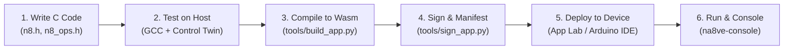

# na8ve-os: Edge AI Operating System & Developer SDK

**A cognitive operating system and application runtime for resource-constrained microcontrollers and heterogeneous edge silicon.**

`na8ve-os` is an open, modular operating system framework engineered to execute deterministic, sandboxed ambient intelligence directly on low-power hardware. It executes deterministic, sandboxed intelligence directly on bare-metal with zero cloud dependencies. It bridges enterprise-grade capability security, zero-trust sandboxing, and local neural state recurrence on constrained microcontrollers (such as the **Seeed Studio XIAO ESP32-S3 Sense**) and heterogeneous edge processors (such as the **Arduino Uno Q**).

---

## 1. System Architecture

The operating system establishes a mathematically verifiable boundary between the minimal Trusted Intelegent Computing Base and userland applications.

### Architectural Pillars

1. **Recurrent Byte-Level Intelligence**: Eliminates the $O(T)$ Key-Value (KV) cache memory wall by accumulating state in a compact, fixed-rank associative **neuron** matrix using Block Floating Point **synapse** quantization (`synapse-16`, `synapse-8`, `synapse-4`). Memory consumption is strictly $O(1)$ in sequence length.
2. **Single-Writer Persistent Memory Graph**: The graph holds the ground-truth facts; a neural model never does. All facts reside in an embedded relational/graph store (`excel.csv`) on Core 0. Retractions unconditionally unwind associative synapse state in the same transaction, preventing hallucinations without retraining.
3. **Zero-Trust Capability IPC**: Applications execute inside sandboxed WebAssembly execution environments (WAMR) with zero ambient authority. All inter-process communication and hardware actuation is mediated by capability badges.
4. **Actuator Safety Policy Table**: A neural model or application never directly drives a physical GPIO pin. It proposes actions; the compiled actuator safety table enforces hardware pin reservations, duty cycles, and emergency disconnect interlocks.

---

## 2. Supported Silicon Targets

| Target                              | Silicon Package                 | Compute Cores                                                               | Memory Profile                                                                | Storage                             | Primary Role                                                         |
| :---------------------------------- | :------------------------------ | :-------------------------------------------------------------------------- | :---------------------------------------------------------------------------- | :---------------------------------- | :------------------------------------------------------------------- |
| **Seeed XIAO ESP32-S3 Sense** | Espressif ESP32-S3R8            | Dual-core Xtensa LX7 @ $240\text{ MHz}$ (128-bit PIE SIMD)                | $512\text{ KB}$ SRAM + $8\text{ MB}$ Octal PSRAM                          | $8\text{ MB}$ SPI Flash + MicroSD | Sub-watt ambient edge cognition and audio/sensor monitoring          |
| **Arduino Uno Q**             | Qualcomm QRB2210 + ST STM32U585 | Quad-core Cortex-A53 @ $2.0\text{ GHz}$ (ARM NEON) + Cortex-M33 TrustZone | $2\text{ GB}$ / $4\text{ GB}$ LPDDR4X + $512\text{ KB}$ Coprocessor RAM | $16\text{ GB}$ eMMC 5.1           | High-throughput edge robotics, visual odometry, and motor control    |
| **Host Simulator**            | x86_64 / AArch64                | Native host CPU                                                             | Host Virtual Memory                                                           | Local disk image                    | Deterministic CI testing, fuzzing, and negative control verification |

---

## 3. Developer Application SDK

Applications in `na8ve-os` are written in standard C and compiled into relocatable WebAssembly modules. The SDK provides a freestanding micro-libc with zero dynamic allocations and zero host syscall reach.

### Core Application Lifecycle

Every `na8ve-os` application exports three lifecycle entrypoints:

```c
#include "n8.h"
#include "n8_ops.h"

// Statically allocated 1024-byte message inbox
static uint8_t g_inbox[N8_MSG_MAX] __attribute__((aligned(4)));

// 1. Initialization: called once at boot
N8_EXPORT(n8_init) int32_t n8_init(void) {
    n8_log("app: initialized\n", 17);
    return 0; // Non-zero return halts module
}

// 2. Inbox Memory Offset
N8_EXPORT(n8_inbox) int32_t n8_inbox(void) {
    return (int32_t)(uintptr_t)g_inbox;
}

// 3. Message Dispatch Loop
N8_EXPORT(n8_on_message) int32_t n8_on_message(int32_t from, int32_t op, int32_t len) {
    if (op == N8_OP_PING) {
        return n8_reply_str("status=ok");
    }
    return 0;
}
```

### Mediated System Services

Applications interact with hardware and kernel services through capability-checked imports:

* **`n8_now_us()`**: Monotonic system clock in microseconds.
* **`n8_log(buf, len)`**: Emits structured telemetry to the console ring.
* **`n8_ipc_send(to, op, buf, len)`**: Sends asynchronous IPC messages to peer apps or kernel services.
* **`n8_store_query(query, qlen, k, out, cap)`**: Queries live memories in the Core 0 persistent graph.
* **`n8_reply(buf, len)`**: Sends an immediate response to the active message sender.
* **`n8_model_request(prompt, len, max_tokens)`**: Submits asynchronous cognitive generation turns to the system Model Broker.

---

## 4. Developer Walkthrough: How to Develop and Launch an App

All applications follow a deterministic six-step development lifecycle:



### Prerequisites

* **Compiler**: Zig 0.13.0 (`zig cc`) or Clang/LLVM with WebAssembly target support.
* **Python**: Python 3.10+ (with `cryptography` and `pyserial` packages).
* **Native C Compiler**: GCC or Clang for local host testing.

### Step 1: Write the Application Source

Every application exports three entrypoints (`n8_init`, `n8_inbox`, `n8_on_message`) and declares permissions in `manifest-entry.json`:

```c
#include "n8.h"
#include "n8_ops.h"

static uint8_t g_inbox[N8_MSG_MAX] __attribute__((aligned(4)));

N8_EXPORT(n8_init) int32_t n8_init(void) {
    n8_log("app: initialized\n", 17);
    return 0;
}

N8_EXPORT(n8_inbox) int32_t n8_inbox(void) {
    return (int32_t)(uintptr_t)g_inbox;
}

N8_EXPORT(n8_on_message) int32_t n8_on_message(int32_t from, int32_t op, int32_t len) {
    if (op == N8_OP_PING) return n8_reply_str("status=ok");
    return 0;
}
```

### Step 2: Native Host Unit Testing (No Hardware Required)

Verify application logic locally on your desktop before touching silicon:

```bash
# 1. Run unit test suite
cd examples/hello-app
gcc -I../../sdk/include hello.c test_hello.c ../../sdk/src/n8_util.c -o test_hello
./test_hello

# 2. Run mandatory failing control twin
gcc -DEXPECT_MISMATCH -I../../sdk/include hello.c test_hello.c ../../sdk/src/n8_util.c -o test_hello_control
./test_hello_control
```

### Step 3: Compile to WebAssembly

Use the SDK's cross-compilation pipeline:

```bash
python ../../tools/build_app.py --name hello --src hello.c --out dist/
```

### Step 4: Sign Container & Generate Manifest

```bash
# Sign the Wasm module into an authenticated .n8pv container
python ../../tools/sign_app.py sign --name hello dist/hello.wasm dist/hello.n8pv

# Compile the capability grant table
python ../../tools/build_manifest.py manifest-entry.json --out dist/manifest.bin
```

### Step 5: Deploy User App to Target Hardware

Once you have installed `na8ve-os` from the **Firmware** tab (Uno Q) or received your factory pre-flashed hardware from the **Shop**, deploy signed `.n8pv` application packages directly to your board:

* **Arduino Uno Q (Community Beta 1M or Pre-Flashed / N8LC Licensed)**:
  Package your app with the **Arduino App Lab** SDK (`sdk/arduino-app-lab/`) and use **Import App** in App Lab with the resulting `.zip`. The na8ve-os firmware itself is installed from the **Firmware** page of the distribution site, never from this repository.
* **Seeed Studio XIAO ESP32-S3 Sense (Pre-Flashed `NA8-XIAO-S3-PRE` Kit)**:
  The na8ve-os firmware is available only factory-flashed on the pre-flashed kit. Install the **Arduino IDE** board package (`sdk/arduino-ide/`), pair your workstation signing key (`~/.na8ve/app-key.pem`) once over USB, and press **Upload**: the IDE streams your signed `.n8pv` to the running OS, and the factory OS remains untouched.

The **Apps** page of the distribution site also installs the prebuilt example apps over USB, from the browser.

### Step 6: Connect and Interact via Console & Tools

Connect to the running operating system using our production operator interfaces:

* **Browser-Native Web Console & Live View (Recommended)**:
  Open the official web flasher in Chrome or Edge over WebSerial. Switch to the **Interactive Console** to issue commands and chat, or the **Live Vision View** to view camera perception in real time—with zero local software installation.
* **In-Device Native ANSI Terminal**:
  Connect any terminal (PuTTY, minicom, screen, Windows Terminal) to the serial port or TCP port `7878`. The firmware outputs rich VT100/ANSI graphics:

  - `tui`: Clears the screen and draws the full system status dashboard.
  - `vision`: Emits the 64x64 ASCII camera viewport and neural detection frame.
  - `help`: Full color-coded command syntax reference.
* **Unified Command-Line Client (CLI)**:
  Lightweight CLI for rapid local scripting and automated CI, downloadable from the **Apps** page (**Desktop Tools**):

  ```bash
  na8ve-console
  # On serial boards (e.g. XIAO ESP32-S3 Sense):
  # na8ve-console --port COM4
  ```

*(On Arduino Uno Q via ADB, `na8ve-console` automatically forwards port `7878` to `127.0.0.1`).*

Once connected, run `os-info` to check system state, `os-call 1 1` to ping the model broker, or `chat <prompt>` to stream recurrent byte-model inference in real time.

---

### The Physical Hardware Path & Actuator Policy Table (`os-table`) Process

In `na8ve-os`, applications have **zero ambient authority** over physical hardware:

1. **Physical Hardware Partitioning (Arduino Uno Q)**:
   - High-level cognition and sandboxed Wasm applications run on the **Qualcomm QRB2210 Application Processor** (Quad Cortex-A53).
   - Physical I/O pins, PWM timers, and the $12\times 8$ LED matrix are wired directly to the **STM32U585 Microcontroller Coprocessor**.
   - The two chips communicate exclusively across an internal high-speed UART (`/dev/ttyHS1` @ 115,200 baud) using signed binary command frames.
2. **The Actuator Proposal Pattern**:
   - An application or neural model never sets physical GPIO pins directly.
   - Applications dispatch proposals to Core 0:
     ```c
     n8_ipc_send(0, N8_OP_ACTUATE, "act target=relay state=on", len);
     ```
3. **Core 0 Reference Monitor & Policy Enforcement (`cx_act`)**:
   - **Gate 1 (Allow-List)**: Checks if the target is in the compiled `CX_ACTUATORS[]` table (viewable via `os-table` in console).
   - **Gate 2 (State Validation)**: Verifies the proposed state against permitted states (e.g. `{off, on}`).
   - **Gate 3 (Rate Limiting)**: Enforces `min_interval_ms` to prevent physical chatter.
   - **Gate 4 (Thermal/Duty Protection)**: Enforces `max_on_ms` timeouts.
   - **Gate 5 (Interlocks & Pin Reservations)**: Ensures reserved boot, flash, and debug pins (`CX_PIN_RESERVED`) are never touched.
   - Only when all five gates pass does Core 0 serialize the command across `/dev/ttyHS1` to the STM32 coprocessor.
4. **Why Natural Language Chat Does Not Drive Hardware**:
   - Sending text like `Hello` in `na8ve-console` triggers `os-chat` directly into the raw **System 2 Model Broker (`cortex-mvp`, pVM #1)**.
   - `os-chat` is a diagnostic benchmark: it streams raw tokens back to your PC terminal and does not route through any userland application or actuator.
   - To drive actuators through an app, you send structured IPC messages (`os-call <app_id> <op> [payload]`), which the application intercepts and transforms into Core 0 actuation proposals.

---

## 5. System Applications & Operator Tools

`na8ve-os` supports multiple zero-footprint operator interfaces, from browser-native and on-device firmware consoles to host development utilities:

### A. Browser-Native Web Console & Live View

* **Overview**: Accessible in Google Chrome and Microsoft Edge via WebSerial in the official web flasher:
  - **Interactive Console Tab**: Command chips (`tui`, `status`, `readings`, `acts`, `periph`), interactive command bar, and streaming token transcript.
  - **Live Vision View Tab**: Real-time camera viewfinder canvas, object classification label, dynamic confidence percentage bar, and one-click cognitive turn routing to `cortex-mvp` (pVM #1).
  - **Obfuscated & Zero-Install**: Hardened with WebAssembly and minified JS bundles, ensuring no models or prompts are exposed.

### B. In-Device Native ANSI Terminal

* **Overview**: Connect directly via USB serial or TCP using any standard terminal (PuTTY, minicom, screen, Windows Terminal). The firmware natively implements rich ANSI formatting:
  - `tui`: Renders the full interactive system dashboard (neuron state, synapse memory, active model, and hardware peripherals).
  - `vision`: Displays the 64x64 ASCII camera viewfinder and neural object recognition frame.
  - `help`: Full color-coded command syntax reference.

### C. Unified Command-Line Client (CLI)

* **Launcher**: `na8ve-console` (from the **Apps** page, **Desktop Tools**)
* **Overview**: Lightweight terminal client for rapid scripting, low-overhead serial interaction, IPC testing (`os-call`), and automated CI workflows.

---

## 6. Distribution Site: Firmware, Standalone Apps & Desktop Tools, Shop Products (`10 Day Backorder`) & Licence (`N8LC`)

The official `na8ve` distribution site organizes device provisioning, application deployment, desktop operator tooling, and hardware fulfillment into three primary navigation sections: **Firmware** (`/`), **Apps** (`/apps`), and **Shop** (`/shop`).

### 6.1 Firmware (`/`) — Browser WebUSB Releases for Arduino Uno Q

Use Chrome or Edge on desktop over USB-C to provision an Arduino Uno Q directly from the **Firmware** page:

| Release | Edition | Models & Capabilities | Pricing |
| :--- | :--- | :--- | :--- |
| **`na8ve-os · Uno Q (Community Beta 1M)`** (`na8ve-os-unoq`, `0.1.0-beta.1`) | Community Beta | `na8ve-osd`, App Lab Web UI, `cortex-mvp`, STM32U585 bridge, and **1M Master only** (`bx-1m-l2-t036`, `int32`). Keeps `_b` recovery slot intact. | **Free** |
| **`na8ve-os · Uno Q (Pre-Flashed)`** (`na8ve-os-unoq-preflashed`, `0.1.0`) | Pre-Flashed / Licensed Enclave | Production OS with **1M (`bx-1m-l2-t036`, `int32`)**, **2M (`bx-2m-t035`, `int32`)**, and **Vision (`vn8v-tin66`, `float32`)**, MAC-bound `1,024-byte` `N8LC` licence verification, and buyer-delegated RSA-3072-PSS app signing. Dev diagnostic probes omitted. | **`$69.00` Licence Key** (BYO Uno Q) or included with **`$149.00`** hardware |

> **Platform Availability Note (ESP32-S3):** **Seeed Studio XIAO ESP32-S3 Sense** does **not** have a public browser WebSerial OS flasher on the distribution site. XIAO ESP32-S3 Sense is available **only as a Pre-Flashed ESP32 product (`NA8-XIAO-S3-PRE`)** through the **Shop**, arriving with the signed runtime and neural model partition factory-installed and ready for Arduino IDE `.n8pv` app uploads.

### 6.2 Apps (`/apps`) — Standalone SDK Applications & Desktop Tools (TUI & Vision)

The **Apps** tab provides one-click USB installation and direct package downloads for free standalone applications running in `na8ve-os` hardware sandboxes, plus native cross-platform operator tooling for your desktop workstation.

#### Page Layout & Controls
* **Same-Row Filter & Search Controls**: The filter tabs (`All`, `Arduino Uno Q · App Lab`, `XIAO ESP32-S3 · Arduino IDE`, `Desktop Tools (TUI & Vision)`) and live search input bar remain locked side-by-side in the same horizontal row with responsive horizontal scrolling on compact viewports.
* **Non-Transparent, Theme-Matched Cards**: All application cards feature solid, high-contrast surfaces (`var(--surface)`) matching the visual theme of the **Firmware** and **Shop** cards.
* **Target Hardware Specification Banners**: Every card features a dedicated hardware banner detailing silicon microarchitectures:
  * **Arduino Uno Q**: `Qualcomm QRB2210 (Quad Cortex-A53 @ 2.0 GHz) + STM32U585 Coprocessor` (`KVM STAGE-2`).
  * **Seeed Studio XIAO ESP32-S3 Sense**: `Espressif ESP32-S3R8 (Xtensa LX7 @ 240 MHz, 8MB PSRAM, OV2640, PDM mic)` (`XTENSA LX7`).
  * **Desktop Operator Tools**: `Windows x64 (.exe) · Linux x86_64 · macOS Apple Silicon (arm64)` (`MULTI-PLATFORM`).
* **Vertical Button Hierarchy**: The primary **"Install via USB"** button is stacked vertically directly **above** the **"Package"** download and GitHub source repository link row.

#### A. Free Standalone Edge Sandbox Applications

These applications are 100% free and contain **zero underlying OS firmware, bootloaders, or models**. They install strictly into the user application sandbox, preserving the running operating system and on-device models:

* **For Arduino Uno Q (Arduino App Lab):**
  * **Developer SDK Starter App (`na8ve-developer-sdk`)**: Official starter sandbox with KVM Stage-2 isolation, memory graph recall query hooks, and Python Brick bridge.
  * **LED Matrix Cognitive Visualizer (`matrix-app`)**: Real-time 8x12 LED matrix cognitive turn and attention visualizer via STM32 coprocessor.
  * **Smart Greenhouse Reflex Agent (`greenhouse-app`)**: Closed-loop environmental cognitive monitor, Vapor Pressure Deficit (VPD) calculator, and actuator reflex proposals.
  * **Vision Saccade Classifier (`image-app`)**: Privacy-preserving edge visual classifier with 32x8 ASCII terminal viewports and zero raw image persistence.
  * **Inter-Sandbox Model Broker (`broker-app`)**: Asynchronous IPC query coordinator routing natural language generation turns between isolated sandbox slots.

* **For Seeed Studio XIAO ESP32-S3 (Arduino IDE):**
  * **Arduino IDE Developer SDK (`na8ve-developer-sdk-esp32`)**: Demonstrates serial console cognitive turns, graph recall queries, and actuator policy enforcement.
  * **Greenhouse Environmental Agent (`greenhouse-agent-esp32`)**: Autonomous environmental monitor with sensor seam sampling and Core 0 actuator safety tables.
  * **Minimal Standalone Sandbox (`hello-app-esp32`)**: Minimal reference sandbox demonstrating turn state persistence and sub-millisecond IPC ping/pong latency.
  * **Edge IPC Query Coordinator (`broker-app-esp32`)**: Standalone IPC query coordinator routing sensory observations between isolated sandbox slots.

> **USB Installation & Zero Firmware Overwrite Policy:** When you click **Install via USB** on any application card, the installer writes strictly to the isolated user application sandbox (`Stage-2 MicroVM` on Uno Q; `Hardware Isolated` user slot on ESP32-S3). No base OS bootloader, kernel, hypervisor, partition table, or models are touched. Once installed, simply power cycle or start your board to run the application immediately.

#### B. Desktop Operator Tools (TUI & Vision)

Download native, self-contained desktop binaries from the **Desktop Tools** category on the Apps page:

| Desktop Tool | Description | Windows x64 | Linux x86_64 | macOS Apple Silicon |
| :--- | :--- | :--- | :--- | :--- |
| **`na8ve-tui`** | High-performance interactive terminal user interface. Connects over USB serial (ESP32-S3) or TCP socket (Uno Q), featuring real-time conversation streaming, live token agreement metrics, episodic memory graph inspection, and device telemetry. | [`na8ve-tui.exe`](/tools/na8ve-tui.exe) | [`na8ve-tui`](/tools/na8ve-tui) | [`na8ve-tui-darwin-arm64`](/tools/na8ve-tui-darwin-arm64) |
| **`na8ve-vision`** | Real-time edge visual perception monitor. Streams 32x8 ASCII camera viewports, foveated bounding-box detections, confidence intervals, and cognitive situation reports over USB with zero raw pixel retention. | [`na8ve-vision.exe`](/tools/na8ve-vision.exe) | [`na8ve-vision`](/tools/na8ve-vision) | [`na8ve-vision-darwin-arm64`](/tools/na8ve-vision-darwin-arm64) |
| **`na8ve-console`** | Headless CLI and automation tool for scripted turn requests, memory graph dumps, and actuator audit verification. | [`na8ve-console.exe`](/tools/na8ve-console.exe) | [`na8ve-console`](/tools/na8ve-console) | [`na8ve-console-darwin-arm64`](/tools/na8ve-console-darwin-arm64) |

### 6.3 Shop (`/shop`) — Hardware Products (`10 Day Backorder`)

All hardware SKUs in the **Shop** ship as factory-provisioned units on a **`10 Day Backorder`** (`Ships within 10 days`):

| SKU | Product Name | What Ships in the Box | Price | US Tracked Ground Shipping |
| :--- | :--- | :--- | :---: | :---: |
| **`NA8-UNOQ-PRE`** | **na8ve-os · Arduino Uno Q Pre-Flashed Enclave Edition** | Arduino Uno Q (QRB2210 + STM32U585) factory-flashed with `EL2` KVM isolation, `na8ve-osd`, App Lab UI, **1M + 2M + Vision** models, USB-C cable, and your bound `N8LC` + RSA-3072-PSS developer signing key. | **`$149.00`** | **Free** (`$100+` order) |
| **`NA8-XIAO-S3-PRE`** | **na8ve-os · XIAO ESP32-S3 Sense Pre-Flashed Kit** | Seeed XIAO ESP32-S3 Sense (`240 MHz` dual LX7, `8 MB` octal PSRAM, `8 MB` Flash, OV2640 camera, PDM mic, microSD slot) factory-flashed with signed `na8ve-os` firmware and model partition. **Only way to acquire `na8ve-os` on XIAO ESP32-S3.** | **`$49.00`** | **`$9.00`** (Free on `$100+` orders) |
| **`NA8-DUO-BUNDLE`** | **na8ve Complete Edge Kit (Uno Q Pre-Flashed + XIAO ESP32-S3 Sense)** | Both pre-flashed boards paired together with a delegated RSA-3072-PSS developer signing key, App Lab + Arduino IDE starter SDK access, and USB-C data cables. | **`$185.00`** *(compare `$198.00` — Save `$13.00`)* | **Free** (`$100+` order) |

* **International & Express Rates:** Tracked Ground is `$14.00` (Canada) and `$19.00` (International); 2-Day Express is `$24.00` (US) and `$39.00` (International).
* **Order Lookup:** Use **Track Existing Order** on the **Shop** page with your **Order ID** and email address to check fulfillment and tracking status.

### 6.4 How to Purchase & Attach a Licence Key (`N8LC`) for Uno Q

To unlock the full **Pre-Flashed Enclave (`na8ve-os-unoq-preflashed`, 1M + 2M + Vision)** on a bring-your-own Arduino Uno Q (or re-flash/re-bind a pre-flashed unit from the **Firmware** page):

1. **Select the Licensed Card:** On **Firmware** (`/`), click **`na8ve-os · Uno Q (Pre-Flashed)`** (`$69.00`) to expand the **Purchase Licence Key (`N8LC`)** panel.
2. **Prepare Your Developer App Signing Key (RSA-3072-PSS):**
   * **Browser option (quickest):** Click **`Generate & download app-key.pem`** to generate an RSA-3072 keypair directly in Chrome/Edge Web Crypto and save `app-key.pem` to `~/.na8ve/app-key.pem` (this authorizes `.n8pv` apps you build and sign on your workstation).
   * **CLI option:** Run `keygen` locally (`sdk/arduino-app-lab/tools/na8ve_applab_tool.py keygen --key ~/.na8ve/app-key.pem`) and click **`Load pubkey.bin`** (`384`/`388` bytes) so the flasher binds your public key.
3. **Purchase or Attach Your Licence:**
   * Click **`Buy`** (`$69.00`) to complete checkout (which fills in your checkout session token `cs_live_...` / `cs_test_...`), **or** paste an existing checkout session token, **or** click **`Attach pre-minted .n8lc licence file`** if you already hold a `1,024-byte` `N8LC` file.
4. **Target Board MAC & Flash:**
   * Optionally enter your board's 6-byte hardware MAC (`aa:bb:cc:dd:ee:ff`), or leave it blank to auto-derive the identity from your USB-connected Uno Q during handshake.
   * Choose an install action (**`Install OS`**, **`Clean na8ve-os reinstall`**, or **`Factory reset`**) and click **`Connect & install`**.
   * The browser mints your MAC-bound `1,024-byte` `N8LC` block, flashes Slot A safely (`hyp_a` verified before `boot_a` while preserving `_b` fallback), and provisions `/etc/na8ve-os/licence.n8lc` plus your delegated public key.
5. **Back Up Your Minted File:** Click **`Save minted .n8lc`** after flashing completes so you keep an offline backup alongside `~/.na8ve/app-key.pem`.

---

## 7. Reference Examples

* **[`examples/hello-app/`](examples/hello-app/)**: Minimal application demonstrating state persistence across turns, monotonic timing, and memory graph queries.
* **[`examples/broker-app/`](examples/broker-app/)**: Submits asynchronous natural language generation turns to the system model broker without holding direct accelerator privileges.
* **[`examples/matrix-app/`](examples/matrix-app/)**: Streams na8ve neural model responses to the Arduino Uno Q $12\times 8$ LED matrix display via capability-brokered actuator proposals.
* **[`examples/greenhouse-app/`](examples/greenhouse-app/)**: Complete smart greenhouse reflex controller evaluating BME680 environmental packets, computing Vapor Pressure Deficit (VPD), and proposing relay actuations.

---

## 8. Platform SDKs & Documentation Suite

Developer SDKs, starter templates, and technical references:

### Target Platform SDKs

* **[`sdk/arduino-app-lab/`](sdk/arduino-app-lab/README.md)**: Arduino App Lab SDK for **Arduino Uno Q** (`tools/na8ve_applab_tool.py`, Python `na8ve.app_bricks`, Zero-Leak `.zip` packaging, Community Beta 1M vs Pre-Flashed `$69.00` `N8LC` setup).
* **[`sdk/arduino-ide/`](sdk/arduino-ide/README.md)**: Arduino IDE `na8ve:esp32s3` board package and `Na8veOS`/`Na8veModel`/`Na8veStore`/`Na8veAct`/`Na8veSeam` headers for **Seeed XIAO ESP32-S3 Sense Pre-Flashed (`NA8-XIAO-S3-PRE`)** hardware.

### SDK & Architecture Guides (`docs/sdk-guide/`)

* **[`00-README.md`](docs/sdk-guide/00-README.md)**: Developer SDK overview, memory budgets, and quickstart cheat sheet.
* **[`01-c-client-headers-and-api.md`](docs/sdk-guide/01-c-client-headers-and-api.md)**: Complete reference for `n8.h`, `n8_ops.h`, lifecycle entrypoints, and kernel host imports.
* **[`02-freestanding-runtime-and-micro-libc.md`](docs/sdk-guide/02-freestanding-runtime-and-micro-libc.md)**: Freestanding zero-allocation runtime and micro-libc.
* **[`03-async-model-broker-api.md`](docs/sdk-guide/03-async-model-broker-api.md)**: Asynchronous natural language generation via `n8_model.h`.
* **[`04-host-testing-and-negative-controls.md`](docs/sdk-guide/04-host-testing-and-negative-controls.md)**: Native host testing methodology and mandatory failing control twins (`-DEXPECT_MISMATCH`).
* **[`05-compilation-signing-and-packaging-toolchain.md`](docs/sdk-guide/05-compilation-signing-and-packaging-toolchain.md)**: Toolchain workflow for compiling to WebAssembly, signing binaries, and generating manifest tables.
* **[`06-walkthrough-hello-and-broker-examples.md`](docs/sdk-guide/06-walkthrough-hello-and-broker-examples.md)**: End-to-end app walkthroughs with memory queries and broker requests.
* **[`07-developer-walkthrough-how-to-launch-an-app.md`](docs/sdk-guide/07-developer-walkthrough-how-to-launch-an-app.md)**: Complete guide to developing, unit testing, compiling, signing, and launching an app on edge hardware.

---

## 9. Issue Reporting & Contributing

This repository serves as the public developer resource, SDK distribution, and primary issue tracker for `na8ve-os`:

* **Bug Reports**: Please open an issue using the [Bug Report Template](.github/ISSUE_TEMPLATE/bug_report.md) with serial logs, manifest settings, and hardware details.
* **Feature Requests**: Submit proposals using the [Feature Request Template](.github/ISSUE_TEMPLATE/feature_request.md).
* **Silicon Compatibility**: Share test results on new hardware targets using the [Device Compatibility Template](.github/ISSUE_TEMPLATE/device_compatibility.md).

---

## 10. License

The `na8ve-os` Application SDK, developer tools, and examples are licensed under the Apache License, Version 2.0. Third-party components and runtime exceptions are noted in [`LICENSES/`](LICENSES/).
