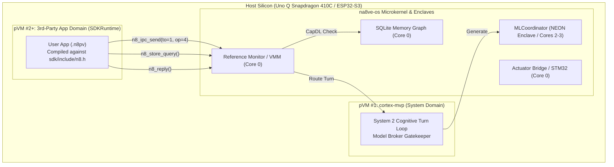

# na8ve-os Application SDK — Developer User Guide

The **na8ve-os Developer Application SDK** (`firmware/pvm/sdk/`) provides the C client interfaces, freestanding runtime libraries, and build toolchains required to author, test, sign, and package secure application modules (`.wasm` / `.n8pv`) for **na8ve-os**.

Whether targeting the **Seeed XIAO ESP32-S3 Sense** (supplied factory pre-flashed via `NA8-XIAO-S3-PRE` or `NA8-DUO-BUNDLE`) or the **Arduino Uno Q (QRB2210 + STM32U585)** (provisioned from the **Firmware** tab as free **Community Beta 1M** or **`$69.00` Pre-Flashed `N8LC` Enclave**, or ordered pre-flashed via `NA8-UNOQ-PRE` in the **Shop**), applications run inside isolated micro-virtual machines (pVMs) managed by WAMR (WebAssembly Micro Runtime) and guarded by capability-based reference monitors.

---

## 1. Package Structure & Table of Contents

This multi-file package is organized into ten modular guides:

| File | Title | Description |
|---|---|---|
| [`00-README.md`](00-README.md) | **SDK Overview & Quickstart** | Package index, architecture summary, silicon limits, and quickstart cheat sheet. |
| [`01-c-client-headers-and-api.md`](01-c-client-headers-and-api.md) | **C Client Headers & System API** | Full reference for `n8.h`, `n8_ops.h`, and `n8_imports.txt`; required exports and kernel host imports. |
| [`02-freestanding-runtime-and-micro-libc.md`](02-freestanding-runtime-and-micro-libc.md) | **Freestanding Runtime & Micro-Libc** | Zero-dynamic-allocation runtime (`n8_libc.c`, `n8_stdio.c`, `n8_util.c`, `libc/`), memory layouts, and stack-first shadow stacks. |
| [`03-async-model-broker-api.md`](03-async-model-broker-api.md) | **Async Model Broker Client** | Submitting neural generation turns to pVM #1 (`cortex-mvp`) via `n8_model.h`; anti-confused-deputy security policies. |
| [`04-host-testing-and-negative-controls.md`](04-host-testing-and-negative-controls.md) | **Host Testing & Negative Controls** | Writing native unit tests (`N8_HOST_TEST`), mocking the kernel, TOCTOU safety, and mandatory failing control twins (`-DEXPECT_MISMATCH`). |
| [`05-compilation-signing-and-packaging-toolchain.md`](05-compilation-signing-and-packaging-toolchain.md) | **Build, Sign & Packaging Toolchain** | Compiling with `zig cc` (`wasm32-freestanding`), signing with `tools/sign_app.py`, manifest generation with `tools/build_manifest.py`. |
| [`06-walkthrough-hello-and-broker-examples.md`](06-walkthrough-hello-and-broker-examples.md) | **End-to-End App Walkthroughs** | Complete step-by-step tutorials building, testing, and deploying `hello-pvm` and `broker-pvm`. |
| [`07-developer-walkthrough-how-to-launch-an-app.md`](07-developer-walkthrough-how-to-launch-an-app.md) | **How to Develop & Launch an App** | Step-by-step guide from C implementation to host tests, Wasm compilation, signing, manifests, and live console connection. |

---

## 2. Core Architectural Philosophy

### A. Principle of Least Authority (PoLA)
An application starts with zero ambient authority. It cannot:
* Allocate unconstrained dynamic heap memory (linear memory is statically bounded).
* Read or write physical I/O pins, GPIO lines, or peripheral registers directly.
* Issue network requests or access storage outside explicit, manifest-granted permissions.

### B. Hardware-Isolated Execution Domains


### C. Message-Passing Inter-Process Communication
All communication occurs via typed messages passed through the kernel's reference monitor:
1. Messages are at most `N8_MSG_MAX = 1024` bytes.
2. The kernel copies incoming payload bytes directly into the app's inbox before calling `n8_on_message()` (preventing Time-Of-Check to Time-Of-Use [TOCTOU] races).
3. Outgoing IPC calls (`n8_ipc_send`) are validated against the sender's manifest `allowed_ipc` bitmask.

---

## 3. Developer Prerequisites & Tooling

To develop apps using the SDK, the following toolchain components are required:

| Component | Pinned Version / Path | Purpose |
|---|---|---|
| **Zig Compiler** | `zig 0.13.0` (`ziglang` via pip) | Provides `zig cc` and `wasm-ld` targeting `wasm32-freestanding`. |
| **Python Environment** | Python 3.10+ (ESP-IDF v5.5.5) | Runs `tools/build_pvm.py`, `tools/sign_pvm.py`, and `tools/build_manifest.py`. |
| **Host C Compiler** | MinGW `cc` (Windows) or GCC/Clang (Linux) | Compiles native host unit tests (`test_*.c`). |
| **Operator Keystore** | RSA-3072-PSS PEM (`~/.na8ve/app-key.pem`) | Generated via `Generate & download app-key.pem` in the browser **Purchase Licence Key (N8LC)** panel or `tools/na8ve_applab_tool.py keygen`; kept strictly outside repositories. |

### Getting na8ve-os on a Board

* **Arduino Uno Q:** install na8ve-os from the **Firmware** page of [dev.na8ve.com](https://dev.na8ve.com): **Community** (free, the 1M model, through a free checkout) or **Pre-Flashed** (the 1M, 2M and Vision models, with a paid board licence). See the main README, *Getting na8ve-os, the Apps, and a Board Licence*.
* **Seeed Studio XIAO ESP32-S3 Sense:** na8ve-os comes only on pre-flashed hardware from the **Shop**.
* **Apps:** the **Apps** page installs the example apps on a board over USB, without touching na8ve-os or its models.

### Quick Environment Check
```bash
# Verify zig compiler
zig version
# Expected: 0.13.0

# Verify cryptography library in Python
python -c "import cryptography; print(cryptography.__version__)"
```

---

## 4. Quickstart: 60-Second App Skeleton

Create a minimal app that replies to a ping (`op 1`) with an uptime greeting:

```c
/* my_app.c */
#include "n8.h"

static uint8_t g_inbox[N8_MSG_MAX];

/* 1. Mandatory Exports */
N8_EXPORT(n8_init) int32_t n8_init(void) {
    return 0;
}

N8_EXPORT(n8_inbox) int32_t n8_inbox(void) {
    return (int32_t)(uintptr_t)g_inbox;
}

N8_EXPORT(n8_on_message) int32_t n8_on_message(int32_t from, int32_t op, int32_t len) {
    if (op == N8_OP_PING) {
        int64_t t = n8_now_us();
        char buf[64];
        int at = 0;
        n8_put(buf, &at, sizeof(buf), "pong uptime_us=");
        n8_put_u(buf, &at, sizeof(buf), (uint64_t)t);
        return n8_reply(buf, at);
    }
    return n8_reply_str("ERR unknown op");
}
```

Compile and test using the steps detailed in [`05-compilation-signing-and-packaging-toolchain.md`](05-compilation-signing-and-packaging-toolchain.md).

