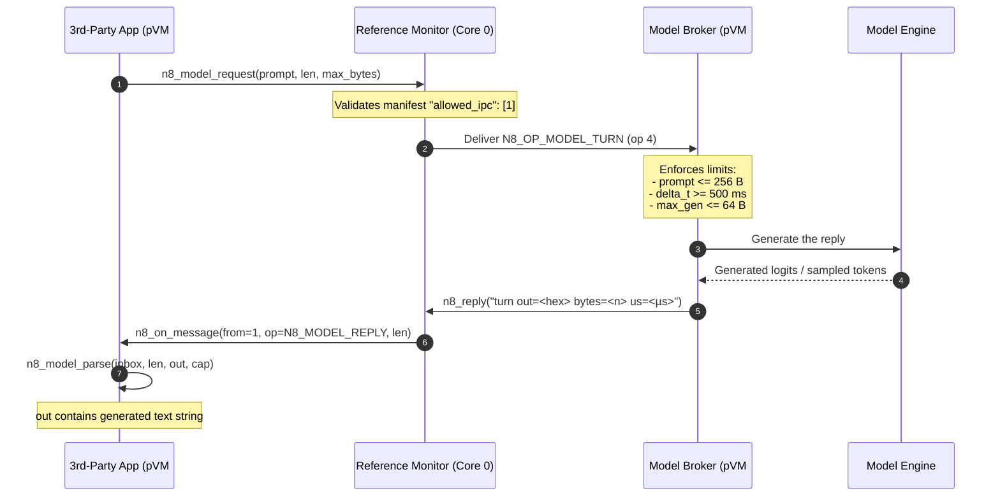

# 03 — Asynchronous Model Broker Client (`n8_model.h`)

Under the na8ve-os capability security architecture, third-party applications never run the model themselves. Instead, cognitive generation is mediated through **pVM #1 (`cortex-mvp`)**, which serves as the system's **Model Broker**.

The SDK's client interface ([`sdk/n8_model.h`](../../sdk/) and [`n8_model.c`](../../sdk/n8_model.c)) encapsulates this asynchronous request-response flow into a simple, high-level API.

---

## 1. Broker Architecture & Data Flow



---

## 2. Security Invariants & Anti-Confused-Deputy Policy

To prevent rogue applications from abusing the broker as a confused deputy, `cortex-mvp` enforces strict policies on every message where `from != 0` (i.e., another pVM):

| Inbound Operation | Permitted to 3rd-Party pVM? | Policy / Constraint |
|---|---|---|
| `N8_OP_PING` (`1`) | **Yes** | Standard ping/pong heartbeat. |
| `N8_OP_MODEL_TURN` (`4`) | **Yes** | Prompt $\le 256$ bytes; generation $\le 64$ bytes; $\ge 500\text{ ms}$ between turns from same sender. |
| `MODEL_OPEN` | **No** (`ERR broker op`) | Forbidden: only the console can change the model's configuration. |
| `MODEL_RECEIPT` | **No** (`ERR broker op`) | Forbidden: reveals internal state hash. |
| `STORE_QUERY` | **No** (`ERR broker op`) | Forbidden: prevents app from querying store through pVM #1's grants. |
| `CHAT*` / `TABLE` | **No** (`ERR broker op`) | Forbidden: prevents driving console output or modifying actuator rules. |

---

## 3. Client API Reference

### 3.1 Constants and Error Codes
```c
#define N8_MODEL_BROKER      1      /* pVM ID of cortex-mvp */
#define N8_MODEL_MAX_PROMPT  256    /* Maximum prompt length */
#define N8_MODEL_MAX_BYTES   64     /* Maximum generated response length */
#define N8_MODEL_REPLY       ((int32_t)(N8_OP_MODEL_TURN | 0x80000000u))

/* Error codes returned by n8_model_request and n8_model_parse */
#define N8_MODEL_E_BUSY     -1   /* Client already has a request in flight */
#define N8_MODEL_E_RATE     -2   /* "ERR broker rate": < 500 ms since last turn */
#define N8_MODEL_E_SIZE     -3   /* "ERR broker size": prompt exceeded 256 bytes */
#define N8_MODEL_E_MODEL    -4   /* "ERR no-model": model partition not mounted */
#define N8_MODEL_E_REPLY    -5   /* Malformed reply or broker refusal */
```

### 3.2 Functions

#### `n8_model_pending`
```c
int32_t n8_model_pending(void);
```
* Returns `1` if a model turn request is currently awaiting response from pVM #1, or `0` if idle.

#### `n8_model_request`
```c
int32_t n8_model_request(const char *prompt, int32_t n, int32_t max_bytes);
```
* **Parameters:**
  * `prompt`: Pointer to ASCII/UTF-8 input prompt bytes.
  * `n`: Prompt byte count ($0 \le n \le 256$).
  * `max_bytes`: Maximum tokens/bytes to generate ($1 \le \text{max\_bytes} \le 64$).
* **Return Values:**
  * `0`: Request successfully transmitted to the kernel IPC gate.
  * `N8_MODEL_E_BUSY` (`-1`): A turn is already in flight.
  * `N8_MODEL_E_SIZE` (`-3`): Prompt exceeds 256 bytes.
  * Negative: IPC permission failure (sender lacks `"allowed_ipc": [1]`).

#### `n8_model_parse`
```c
int32_t n8_model_parse(const uint8_t *inbox, int32_t len, char *out, int32_t cap);
```
* **Parameters:**
  * `inbox`: Pointer to incoming message buffer (usually from `n8_on_message`).
  * `len`: Length of incoming message.
  * `out`: Destination buffer to write the decoded ASCII string.
  * `cap`: Capacity of destination buffer.
* **Return Values:**
  * $\ge 0$: Number of decoded string bytes written to `out` (always NUL-terminated).
  * `N8_MODEL_E_RATE` (`-2`): Broker rejected request due to rate limit violation ($<500\text{ ms}$).
  * `N8_MODEL_E_SIZE` (`-3`): Broker rejected prompt size.
  * `N8_MODEL_E_MODEL` (`-4`): Neural model is not loaded in flash.
  * `N8_MODEL_E_REPLY` (`-5`): Protocol parsing error.

---

## 4. End-to-End Implementation Pattern

```c
#include "n8.h"
#include "n8_model.h"

static uint8_t g_inbox[N8_MSG_MAX];
static char g_last_answer[64];

#define OP_ASK_AI 0x20

N8_EXPORT(n8_init) int32_t n8_init(void) {
    return 0;
}

N8_EXPORT(n8_inbox) int32_t n8_inbox(void) {
    return (int32_t)(uintptr_t)g_inbox;
}

N8_EXPORT(n8_on_message) int32_t n8_on_message(int32_t from, int32_t op, int32_t len) {
    /* 1. Handling asynchronous reply from the Model Broker */
    if (from == N8_MODEL_BROKER && op == N8_MODEL_REPLY) {
        int32_t bytes = n8_model_parse(g_inbox, len, g_last_answer, sizeof(g_last_answer));
        if (bytes < 0) {
            n8_log("Model Broker error returned", 26);
            return 0;
        }
        n8_log("Received AI completion: ", 24);
        n8_log(g_last_answer, bytes);
        return 0;
    }

    /* 2. User requesting a turn */
    if (op == OP_ASK_AI) {
        if (n8_model_pending()) {
            return n8_reply_str("ERR model busy");
        }
        int32_t rc = n8_model_request((const char *)g_inbox, len, 32);
        if (rc != 0) {
            return n8_reply_str("ERR request rejected");
        }
        return n8_reply_str("ok turn queued");
    }

    return n8_reply_str("ERR unknown op");
}
```

