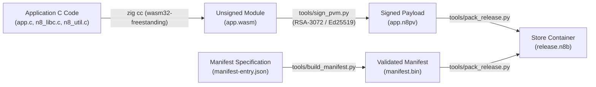

# 05 — Compilation, Signing & Packaging Toolchain

Transforming raw C source code into a verified, signed application package (`.n8pv` / `.n8b`) ready for execution on **na8ve-os** requires three distinct toolchain stages:

1. **WebAssembly Compilation (`zig cc`):** Compiling C to a freestanding `wasm32` module complying with WAMR 2.4.0 opcode rules.
2. **Cryptographic Signing (`tools/sign_pvm.py`):** Generating an `N8PV` container with an RSASSA-PSS or Ed25519 signature verified by `pvmfw` / `SecurityCoordinator`.
3. **Manifest Composition & Verification (`tools/build_manifest.py`):** Compiling human-readable JSON manifests into binary tables validated against silicon budgets and pin safety tables.

---

## 1. Toolchain Overview Pipeline



---

## 2. Step 1: Compiling C to WebAssembly (`zig cc`)

The build uses **Zig 0.13.0** (`zig cc`), which provides Clang 18 and `wasm-ld` targeting freestanding WebAssembly.

### 2.1 Compiler and Linker Flags
```bash
zig cc \
  -target wasm32-freestanding \
  -mcpu=mvp \
  -mbulk-memory \
  -msign-ext \
  -O2 \
  -std=c11 \
  -ffreestanding \
  -fno-builtin-printf \
  -Wall \
  -Werror=implicit-function-declaration \
  -I firmware/pvm/sdk \
  -I firmware/pvm/sdk/libc \
  app.c \
  firmware/pvm/sdk/n8_libc.c \
  firmware/pvm/sdk/n8_util.c \
  -Wl,--no-entry \
  -Wl,--export=n8_init \
  -Wl,--export=n8_inbox \
  -Wl,--export=n8_on_message \
  -Wl,--stack-first \
  -Wl,-z,stack-size=8192 \
  -Wl,--initial-memory=65536 \
  -Wl,--max-memory=65536 \
  -o app.wasm
```

### 2.2 Flag Explanations
* `-target wasm32-freestanding`: Generates bare-metal 32-bit WebAssembly without WASI runtime dependencies.
* `-mcpu=mvp -mbulk-memory -msign-ext`: Matches the exact opcode capabilities supported by WAMR 2.4.0 fast interpreter.
* `-Wl,--no-entry`: Disables looking for standard C `main()`.
* `-Wl,--export=n8_*`: Explicitly exports the three mandatory entrypoints.
* `-Wl,--stack-first`: Positions the call stack at address `0x0` to catch stack overflows before heap corruption.
* `-Wl,--max-memory=65536`: Restricts linear memory ceiling to exactly one 64 KiB page.

### 2.3 Stripping Debug Sections
For production distribution, symbol and producer sections are removed:
```bash
# Using wasm-opt from binaryen
wasm-opt -O4 --strip-debug --strip-producers app.wasm -o app_clean.wasm
```

---

## 3. Step 2: Cryptographic Payload Signing (`tools/sign_pvm.py`)

Every application binary loaded by na8ve-os must carry an `N8PV` header signed by a trusted developer or platform key. The private key must reside strictly outside the repository (default `~/.na8ve/app-key.pem`).

### 3.1 `N8PV` Binary Header Layout (64 Bytes)
```
 0               4               8              12              16
+---------------+---------------+---------------+---------------+
| Magic: "N8PV" |  Version: 1   | HeaderLen: 64 | ModuleLen     |
+---------------+---------------+---------------+---------------+
| SigLen: 384   | App Name (16 bytes, ASCII NUL-padded)         |
+---------------+---------------+---------------+---------------+
| Module SHA-256 Digest (32 bytes)                              |
+---------------------------------------------------------------+
| Raw WebAssembly Module Bytes (ModuleLen bytes)                |
+---------------------------------------------------------------+
| RSASSA-PSS / Ed25519 Signature over SHA-256 (SigLen bytes)    |
+---------------------------------------------------------------+
```

### 3.2 Signing Commands & Browser `N8LC` Key Delegation
```bash
# 1. Generate a workstation RSA-3072-PSS keypair (or generate app-key.pem in the browser Firmware UI)
python sdk/arduino-app-lab/tools/na8ve_applab_tool.py keygen --key ~/.na8ve/app-key.pem

# 2. Extract public key to pair with an Arduino Uno Q (N8LC Purchase Licence Key flow) or Pre-Flashed XIAO ESP32-S3
python sdk/arduino-app-lab/tools/na8ve_applab_tool.py pubkey --key ~/.na8ve/app-key.pem --out ~/.na8ve/app-key.pub.bin

# 3. Sign the application module (.wasm -> .n8pv)
python tools/sign_pvm.py sign \
  --key ~/.na8ve/app-key.pem \
  --name my_app \
  app_clean.wasm \
  my_app.n8pv
```

On the distribution site's **Firmware** (`/`) tab, selecting **`na8ve-os · Uno Q (Pre-Flashed)`** (`$69.00` `N8LC` licence on BYO board, or shipped pre-bound on `NA8-UNOQ-PRE` `$149.00` / `NA8-DUO-BUNDLE` `$185.00`) binds `~/.na8ve/app-key.pub.bin` into `/etc/na8ve-os/` alongside your `1,024-byte` MAC-bound `.n8lc` licence so `pvmfw` trusts modules signed by `~/.na8ve/app-key.pem`. Seeed XIAO ESP32-S3 Sense is distributed exclusively via the **Shop** (`NA8-XIAO-S3-PRE`, `$49.00`, `10 Day Backorder`) with base firmware and neural models pre-flashed; pair your key once over USB before uploading `.n8pv` sketches.

---

## 4. Step 3: Manifest Composition & Verification (`tools/build_manifest.py`)

The manifest defines the security grants, execution budgets, and IPC routing for the application.

### 4.1 Manifest Entry Schema (`manifest-entry.json`)
```json
{
  "id": 2,
  "name": "my_app",
  "partition": "pvm_1",
  "core": 0,
  "payload": "my_app.n8pv",
  "mem_linear": 65536,
  "stack": 8192,
  "budget_ms": 2000,
  "allowed_ipc": [1],
  "grants": [
    {"kind": "store", "label": "query", "rights": "r"}
  ]
}
```

### 4.2 Manifest Validation Invariants
When running `tools/build_manifest.py`, the compiler checks security invariants and immediately rejects unsafe configurations:
* **Reserved Pin Check:** Manifests attempting to drive hardware reserved pins (e.g., GPIO 21 on Sense or UART lines) fail compilation with exit code 2.
* **Grant Legality:** Only recognized grant kinds (`store`, `gpio`, `sensor`, `flash`) are permitted. Third-party apps are rejected if they request any other grant.
* **Memory Budget Fit:** `mem_linear` must not exceed the target partition slot size declared in `partitions.csv`.
* **IPC Mask Consistency:** An entry in `allowed_ipc` targeting a non-existent pVM ID fails validation.

### 4.3 Manifest Build Command
```bash
python tools/build_manifest.py \
  firmware/os/manifest.json \
  --payloads build/payloads \
  --out build/manifest.bin \
  --partitions firmware/os/partitions.csv
```

---

## 5. Automated Build via `tools/build_pvm.py`

To compile, strip, and sign all pVM applications in a single automated step:

```bash
# Set environment variable pointing to external app list
export CX_PVM_APPS='[{"name": "my_app", "src": "examples/my-app", "max_memory": 65536, "stack": 8192}]'

# Run automated builder
python tools/build_pvm.py --out build/payloads --harden
```
This builds each application, applies symbol obfuscation (`harden_pvm.py`), signs the resulting binaries with `sign_pvm.py`, and writes ready-to-flash `.n8pv` files.

