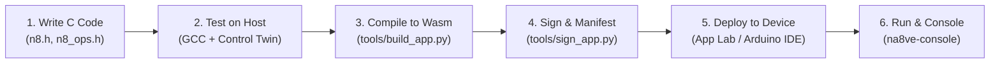

# 07 — Developer Walkthrough: How to Develop and Launch an App

This walkthrough provides a comprehensive, end-to-end guide for developers who clone or fork the **`na8ve-os`** repository and want to create, test, package, and launch a custom edge AI application.

---

## 1. Development Workflow Overview

All `na8ve-os` applications follow a deterministic six-step development lifecycle:



1. **Write Application**: Implement the three mandatory lifecycle functions in freestanding C using the SDK headers (`sdk/include/`).
2. **Native Host Unit Test**: Verify logic on your local machine using standard host compilers (GCC, Clang) with mocked kernel services and mandatory failing control twins (`-DEXPECT_MISMATCH`).
3. **Compile to WebAssembly**: Compile the application into a relocatable, optimized WebAssembly module (`.wasm`) using `tools/build_app.py`.
4. **Sign & Manifest**: Cryptographically sign the module into an authenticated `.n8pv` container and compile the capability grant table (`manifest.bin`).
5. **Deploy to Target Hardware**: Deploy signed modules and manifests with Arduino App Lab (Uno Q) or the Arduino IDE (XIAO ESP32-S3 Sense).
6. **Launch & Connect**: Connect to the running operating system via the unified console client (`na8ve-console`, from the distribution site's **Apps** page).

---

## 2. Step 1: Write the Application Source

Create a new directory under `examples/` (for example, `examples/my-app/`) containing your C source and a `manifest-entry.json` definition.

### Application Source (`my_app.c`)
Every application exports three entrypoints and interacts with the system through capability-checked host imports:

```c
#include "n8.h"
#include "n8_ops.h"
#include "n8_model.h"

#include <stdint.h>
#include <string.h>

/* Statically allocated message inbox */
static uint8_t g_inbox[N8_MSG_MAX] __attribute__((aligned(4)));

/* 1. Initialization: called once at module instantiation */
N8_EXPORT(n8_init) int32_t n8_init(void) {
    n8_log("my-app: initialized and ready\n", 30);
    return 0; // Return 0 on success; non-zero halts module
}

/* 2. Inbox Memory Offset: returns linear memory address of g_inbox */
N8_EXPORT(n8_inbox) int32_t n8_inbox(void) {
    return (int32_t)(uintptr_t)g_inbox;
}

/* 3. Message Dispatch Loop: handles incoming IPC requests */
N8_EXPORT(n8_on_message) int32_t n8_on_message(int32_t from, int32_t op, int32_t len) {
    // Intercept asynchronous model responses from pVM #1 (cortex-mvp)
    if (from == 1 && n8_model_on_message(from, op, len)) {
        return 0;
    }

    if (op == N8_OP_PING) {
        return n8_reply_str("pong from my-app");
    }

    // Submit asynchronous text generation turn to the model broker
    if (op == 0x10) {
        if (n8_model_pending()) {
            return n8_reply_str("ERR busy");
        }
        int32_t rc = n8_model_request((const char *)g_inbox, len, 32);
        return rc == 0 ? n8_reply_str("ok queued") : n8_reply_str("ERR dispatch");
    }

    return 0;
}
```

### Capability Manifest (`manifest-entry.json`)
Declare the application's identity, memory ceiling, budget, and allowed IPC peers:

```json
{
  "id": 2,
  "name": "my-app",
  "partition": "pvm_1",
  "core": 0,
  "payload": "my-app.n8pv",
  "mem_linear": 65536,
  "stack": 8192,
  "budget_ms": 2000,
  "allowed_ipc": [0, 1],
  "grants": []
}
```
* **`id`**: Unique application instance ID (1..8).
* **`core`**: Core affinity (Core 0 for reflex/storage, Core 1 for cognition).
* **`allowed_ipc`**: Destination IDs this application may send messages to (`0` for Core 0 kernel/actuators, `1` for the model broker).
* **`grants`**: Fine-grained hardware capability leases (GPIO, sensor, flash).

---

## 3. Step 2: Native Host Unit Testing

Before compiling to WebAssembly, verify your application's logic on your desktop using native C tests. This eliminates hardware turn-around cycles and ensures fail-stop containment.

### Test Harness (`test_my_app.c`)
```c
#include "n8.h"
#include <stdio.h>
#include <string.h>

static char g_reply[N8_MSG_MAX + 1];

/* Mock Kernel Host Services */
void n8_log(const char *p, int32_t n) { fprintf(stderr, "log: %.*s", (int)n, p); }
int64_t n8_now_us(void) { return 1000000; }
int32_t n8_ipc_send(int32_t to, int32_t op, const void *p, int32_t n) { return 0; }
int32_t n8_reply(const void *p, int32_t n) {
    memcpy(g_reply, p, (size_t)n);
    g_reply[n] = '\0';
    return 0;
}

int main(void) {
    n8_init();

#ifdef EXPECT_MISMATCH
    // Mandatory failing control twin
    n8_on_message(0, 0x99, 0); // Unknown op code
    if (strcmp(g_reply, "pong from my-app") == 0) {
        printf("FAIL: control did not catch mismatch!\n");
        return 1;
    }
    printf("control: mismatch caught successfully (PASSED)\n");
    return 0;
#endif

    n8_on_message(0, N8_OP_PING, 0);
    if (strcmp(g_reply, "pong from my-app") != 0) {
        printf("FAIL: expected pong\n");
        return 1;
    }
    printf("ok test passed\n");
    return 0;
}
```

### Running the Test Suite
```bash
cd examples/my-app

# 1. Run standard unit tests
gcc -I../../sdk/include my_app.c test_my_app.c ../../sdk/src/n8_util.c -o test_my_app
./test_my_app

# 2. Run the mandatory failing control twin
gcc -DEXPECT_MISMATCH -I../../sdk/include my_app.c test_my_app.c ../../sdk/src/n8_util.c -o test_my_app_control
./test_my_app_control
```

---

## 4. Step 3: Compile to WebAssembly

Use the SDK's cross-compilation pipeline tool, [`tools/build_app.py`](../../tools/build_app.py):

```bash
python tools/build_app.py --name my-app --src examples/my-app/my_app.c --out examples/my-app/dist/ --model-client
```

This performs the following steps automatically:
1. Compiles the C source targeting `wasm32-freestanding` using `zig cc` or Clang.
2. Statically links against the SDK's freestanding micro-libc (`sdk/src/n8_libc.c`, `n8_stdio.c`, `n8_util.c`).
3. Links the asynchronous model broker client (`sdk/src/n8_model.c`).
4. Strips debug symbols and applies optimization passes with `wasm-opt`.
5. Emits `examples/my-app/dist/my-app.wasm` (typically 3–5 KB).

---

## 5. Step 4: Sign Container & Compile Manifest

### Sign the WebAssembly Module
Applications must be packaged into an authenticated `.n8pv` container signed with an RSA-3072 operator key:

```bash
# Generate a local operator key (if not already created)
python tools/sign_app.py keygen --key ~/.na8ve/app-key.pem

# Sign the compiled Wasm module into an .n8pv container
python tools/sign_app.py sign --key ~/.na8ve/app-key.pem --name my-app examples/my-app/dist/my-app.wasm examples/my-app/dist/my-app.n8pv
```

### Compile the Binary Capability Manifest
Compile `manifest-entry.json` into the binary capability table verified by the kernel at boot:

```bash
python tools/build_manifest.py examples/my-app/manifest-entry.json --out examples/my-app/dist/manifest.bin
```

`tools/build_manifest.py` verifies all pin assignments against the hardware reserved pin table, checks memory ceilings, and embeds the cryptographic SHA-256 digest of `my-app.n8pv`.

---

## 6. Step 5: Flash & Deploy to Target Hardware

Before deploying user applications:
- **Arduino Uno Q:** install na8ve-os from the **Firmware** page of the distribution site, **Community** (free, through a free checkout) or **Pre-Flashed** (licensed), or order a pre-flashed board from the **Shop**. Load your public key when you license the board so it runs the apps you sign.
- **Seeed Studio XIAO ESP32-S3 Sense:** na8ve-os comes only on pre-flashed hardware from the **Shop**.

Once the board runs na8ve-os, deploy your app with **Arduino App Lab** (`sdk/arduino-app-lab/`), **Arduino IDE** (`sdk/arduino-ide/`), or the distribution site's **Apps** page.

### Installing an Example App from the Apps Page
1. Open the **Apps** page and choose the app for your board.
2. Connect the board over USB and click **Install via USB**.
3. Only the app's own sandbox is written; na8ve-os and its models are left as they are.

### Target: Arduino Uno Q (Qualcomm QRB2210)
Package your app with the Arduino App Lab SDK ([`sdk/arduino-app-lab/`](../../sdk/arduino-app-lab/README.md)) and import the resulting `.zip` in Arduino App Lab with **Import App**. App Lab places `pvm/app.n8pv` and `pvm/manifest.bin` in the app's sandbox; the na8ve-os firmware is installed only from the distribution site's **Firmware** page.

### Target: Seeed Studio XIAO ESP32-S3 Sense (Pre-Flashed `NA8-XIAO-S3-PRE`)
Install the Arduino IDE board package ([`sdk/arduino-ide/`](../../sdk/arduino-ide/README.md)), pair your workstation RSA-3072 key (`~/.na8ve/app-key.pem`) over USB once, select the board's port, and press **Upload**. The IDE streams the signed user application payload to the running OS without overwriting the factory OS or pre-flashed neural model partition, which are available only on pre-flashed hardware.

---

## 7. Step 6: Launch and Connect via Console

`na8ve-os` provides a unified console tool (`na8ve-console`, from the distribution site's **Apps** page under **Desktop Tools**) to communicate with running applications, monitor telemetry, and interact with the recurrent byte-model.

### Target: Arduino Uno Q (Qualcomm QRB2210)
On the Arduino Uno Q, `na8ve-os` executes under hardware hypervisor isolation. 

> [!IMPORTANT]
> The USB serial port exposed to Windows (`COM9` / `/dev/ttyGS0`) is routed by the Linux `arduino-router-serial.service` to port `7500` for Arduino App Lab binary RPC frames. Do not connect plain serial terminals to `COM9`.
> 
> The `na8ve-os` console daemon listens on **TCP port 7878**. Forward this port over ADB:

```bash
# 1. Forward the na8ve console port
adb forward tcp:7878 tcp:7878

# 2. Launch the unified console
na8ve-console --tcp 127.0.0.1:7878
```

### Target: Seeed Studio XIAO ESP32-S3 Sense
On the ESP32-S3 Sense, `na8ve-os` exposes the interactive console directly over USB CDC Serial:

```bash
na8ve-console --port COM4
```

---

## 8. The Physical Hardware Path & Actuator Policy Table (`os-table`) Process

In `na8ve-os`, understanding the hardware topology and the Actuator Safety Table is essential when building apps that control physical devices (LEDs, relays, motors).

### 8.1 The Physical Hardware Path
* **Dual-Chip Architecture on Arduino Uno Q**:
  * **Qualcomm QRB2210**: 64-bit Application Processor (Quad-core Cortex-A53 @ 2.0 GHz) running Linux, the L2 hypervisor, and `na8ve-os` cognitive/userland sandboxes.
  * **STMicroelectronics STM32U585**: Real-time microcontroller coprocessor (Cortex-M33 TrustZone) physically wired to all GPIO headers (`D0..D13`, `A0..A5`), PWM timers, and the $12\times 8$ LED matrix.
  * **Inter-Chip Communication**: The two processors communicate exclusively across an internal high-speed UART (`/dev/ttyHS1` @ 115,200 baud) using authenticated binary command frames.
* **Microcontroller Architecture on Seeed XIAO ESP32-S3**:
  * Dual-core Xtensa LX7 @ 240 MHz. Core 1 runs cognitive recurrent byte inference; Core 0 runs storage (`excel.csv`), sensor polling, and direct GPIO pin driving.

### 8.2 The Actuator Policy Table (`os-table`) Process
A fundamental security law of `na8ve-os` states: **"A neural model or userland application never drives a physical hardware pin directly."**

Applications have **zero ambient authority** over hardware. Instead, all physical interactions follow the **Proposal Pattern**:

```mermaid
sequenceDiagram
    participant APP as Sandboxed App (pVM)
    participant MON as Core 0 Reference Monitor (cx_act)
    participant POL as Actuator Policy Table (os-table)
    participant HW as Hardware Driver / STM32 Coprocessor

    APP->>MON: n8_ipc_send(0, N8_OP_ACTUATE, "act target=relay state=on")
    MON->>POL: cx_act_propose("relay", "on", now_ms)
    POL->>POL: Gate 1: Name in CX_ACTUATORS[] allow-list?
    POL->>POL: Gate 2: State in valid states {off, on}?
    POL->>POL: Gate 3: Rate limit elapsed (now_ms - last_ms >= min_interval_ms)?
    POL->>POL: Gate 4: Timeout enforcement (max_on_ms)?
    POL->>POL: Gate 5: Hardware interlock & pin reservations clear?
    alt Any Gate Fails
        POL-->>MON: REFUSED (Logged to console; pin untouched)
        MON-->>APP: Reply: ERR refused
    else All Gates Pass
        POL->>HW: Serialize authenticated actuation frame (/dev/ttyHS1 or direct GPIO)
        HW-->>POL: ACK applied
        MON-->>APP: Reply: OK applied
    end
```

#### Inspecting the Policy Table (`os-table`)
In the console, run `os-table` to inspect all compiled actuators on your device:
```text
os-table
```
Example Output:
```text
os table kernel n=6 fan{off,low,high} light{off,on} buzzer{off,on} pump{off,on} vent{closed,open} mister{off,on}
OK os-table match=1
```
If an application proposes an actuation for a target or state not permitted by the compiled table, Core 0 rejects the request and logs the fault, protecting physical coils, relays, and displays from erratic software commands.

#### Why Natural Language Chat Does Not Drive Hardware
When typing in `na8ve-console`:
- Typing text like `Hello` or `chat <prompt>` sends `os-chat` directly to the **System 2 Model Broker (`cortex-mvp`, pVM #1)**.
- `os-chat` is a diagnostic benchmark: it streams raw tokens back to your PC terminal and does **not** invoke any application or actuator.
- To drive actuators through an app, you must send structured IPC calls (`os-call <app_id> <op> [payload]`), allowing the app to submit validated proposals through Core 0.

---

## 9. Interactive Console Reference

Once connected, you can interact with the operating system and running applications:

| Command | Action | Description |
|---|---|---|
| `os-info` | Query OS State | Displays OS image, Trusted Computing Base (TCB), RAM allocations, and all running application IDs and states. |
| `os-table` | Actuator Policy | Displays the compiled actuator allow-list, valid states, and rate limits. |
| `os-faults` | Fault Monitor | Lists any containment faults, memory traps, or capability rejections. |
| `os-call <id> <op>` | IPC Message | Sends an IPC message to application `<id>` with operation code `<op>`. Example: `os-call 1 1` pings the model broker (`cortex-mvp`). |
| `chat <prompt>` | Neural Turn | Streams real-time inference tokens from the onboard recurrent byte-model at ~2.5 ms/byte. |
| `Hello` | Direct Prompt | Convenience prefix for submitting chat turns directly to the model broker. |
| `exit` | Disconnect | Closes the console session. |

---

## 10. Summary Checklist for New Apps

Before deploying an application:
- [ ] Application compiles with zero warnings against `sdk/include/`.
- [ ] Statically allocated inbox (`g_inbox`) is aligned to 4 bytes.
- [ ] Host test suite passes all assertions (`./test_app`).
- [ ] Mandatory failing control twin (`./test_app_control`) catches mismatches.
- [ ] `manifest-entry.json` linear memory is a multiple of 64 KB (`65536`).
- [ ] All pin grants avoid the hardware reserved pin list (microSD, flash, PSRAM, USB).
- [ ] Wasm binary is signed with `tools/sign_app.py`.
- [ ] `manifest.bin` compiles cleanly with `tools/build_manifest.py`.
- [ ] Deployed to target with Arduino App Lab (Uno Q) or the Arduino IDE (XIAO ESP32-S3 Sense).

