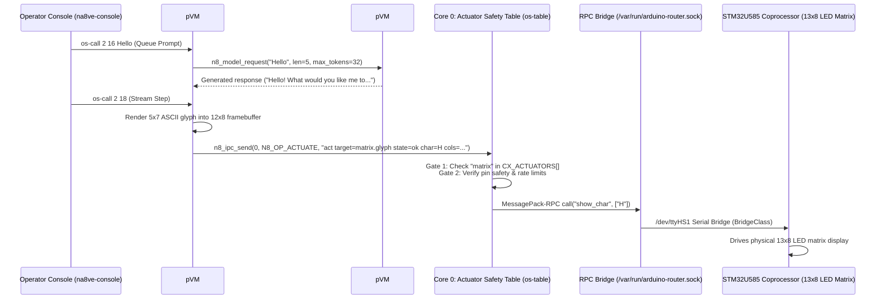

# Arduino Uno Q: na8ve Model LED Matrix Streaming Application

An edge AI application for the **Arduino Uno Q** (Qualcomm QRB2210 application processor + STMicroelectronics STM32U585 TrustZone coprocessor) built using the `na8ve-os` C Application SDK.

The application delegates asynchronous neural generation to the system **Model Broker** (pVM #1: `cortex-mvp`) and safely streams the resulting AI responses character-by-character to the board's onboard **$12 \times 8$ Red LED Matrix Display**.

---

## 1. Architecture & Security Invariants

In `na8ve-os`, third-party applications execute inside sandboxed WebAssembly micro-virtual machines (pVMs) with zero ambient authority:

```
┌──────────────────────────────────────────────────────────┐
│                   Qualcomm QRB2210                       │
│  ┌────────────────────────────────────────────────────┐  │
│  │  pVM #2: Matrix App (matrix.wasm)                  │  │
│  │  • Requests AI turns via n8_model_request()        │  │
│  │  • Maps characters to 5x7 glyphs in 12x8 buffer    │  │
│  │  • Dispatches actuation proposals via N8_OP_ACTUATE│  │
│  └──────────▲──────────────────────────┬──────────────┘  │
│             │ IPC                      │ IPC             │
│  ┌──────────▼─────────────┐ ┌──────────▼──────────────┐  │
│  │ pVM #1: cortex-mvp     │ │ Core 0: Reference       │  │
│  │ (Model Broker)         │ │ Monitor & Actuator Table│  │
│  │ • Autoregressive steps │ └──────────┬──────────────┘  │
│  │ • O(1) synapse-8 state │            │ RPC Bridge      │
│  └────────────────────────┘            │ (UART / SPI)    │
└────────────────────────────────────────┼─────────────────┘
                                         ▼
                 ┌────────────────────────────────┐
                 │    STM32U585 TrustZone MCU     │
                 │   Physical 12x8 LED Matrix     │
                 └────────────────────────────────┘
```

1. **Anti-Confused-Deputy Security**: The app requests AI completions through the Model Broker client (`n8_model.h`) without any direct access to the model.
2. **Actuator Safety Gate**: Under the `na8ve-os` safety policy, an application never drives physical GPIO pins or display hardware directly. Validated proposals (`act target=matrix.glyph state=ok char=<c> cols=<hex>`) are routed through Core 0 and relayed across the secure RPC bridge to the STM32U585 coprocessor.
3. **Dual Telemetry**: Every streamed character is simultaneously rendered to the $12\times 8$ physical LED matrix and logged to the kernel console ring via `n8_log()`.

---

## 2. Application Operation Codes (`n8_on_message`)

| Operation Code | Name               | Direction | Payload       | Description                                                                                                  |
| -------------- | ------------------ | --------- | ------------- | ------------------------------------------------------------------------------------------------------------ |
| `0x00000001` | `N8_OP_PING`     | Inbound   | *None*      | Heartbeat check; replies `pong matrix`.                                                                    |
| `0x00000010` | `OP_PROMPT`      | Inbound   | Prompt string | Submits prompt to Model Broker; replies `ok queued` or error.                                              |
| `0x00000011` | `OP_STATUS`      | Inbound   | *None*      | Returns model text and stream progress (`text <res> \| stream <pos>/<tot>`).                                |
| `0x00000012` | `OP_STREAM_STEP` | Inbound   | *None*      | Steps to next character, updates 12x8 matrix, and dispatches actuation.                                      |
| `0x00000013` | `OP_CLEAR`       | Inbound   | *None*      | Clears 12x8 LED matrix display and resets stream.                                                            |
| `0x00000014` | `OP_STREAM_ALL`  | Inbound   | *None*      | Streams full response across the LED matrix and loops continuously.                                          |
| `0x00000015` | `OP_FRAME_ASCII` | Inbound   | *None*      | Renders active 12x8 matrix framebuffer as ASCII art in terminal.                                             |
| `0x00000016` | `OP_SCROLL_STEP` | Inbound   | *None*      | Marquee shifts 12x8 columns left by 1 pixel for smooth multi-character strolling; loops back at end of text. |

---

## 3. Host Testing & Negative Control Twin

In keeping with `na8ve-os` verification standards, the app includes a native host test suite with a mandatory failing control twin:

```bash
# 1. Run positive test suite
gcc -I../../sdk/include matrix_app.c test_matrix_app.c ../../sdk/src/n8_util.c ../../sdk/src/n8_model.c -o test_matrix_app
./test_matrix_app

# 2. Run negative control twin (broker refusal must be detected)
gcc -DEXPECT_MISMATCH -I../../sdk/include matrix_app.c test_matrix_app.c ../../sdk/src/n8_util.c ../../sdk/src/n8_model.c -o test_matrix_app_control
./test_matrix_app_control
```

---

## 4. Compiling, Signing & Flashing to Hardware

> [!TIP]
> **Working Directory Notice**:
>
> * **When working inside this directory (`examples/matrix-app/`)**:
>   Always prefix tool scripts with `../../tools/`:
>
>   ```bash
>   # Build and sign from inside examples/matrix-app/
>   python ../../tools/build_app.py --name matrix --src matrix_app.c --model-client --out dist/
>   python ../../tools/sign_app.py sign --name matrix dist/matrix.wasm dist/matrix.n8pv
>   python ../../tools/build_manifest.py manifest-entry.json --out dist/manifest.bin
>   ```
> * **When connecting to the board**:
>   Use the desktop operator tools from the distribution site's **Apps** page (**Desktop Tools**):
>
>   ```bash
>   na8ve-console --tcp 127.0.0.1:7878
>   # or for the interactive TUI:
>   na8ve-tui --tcp 127.0.0.1:7878
>   ```

### Step 1: Compile to Freestanding WebAssembly

Compile the C application to a relocatable, optimized WebAssembly module:

```bash
python ../../tools/build_app.py --name matrix --src matrix_app.c --model-client --out dist/
```

This generates `dist/matrix.wasm` (~4.5 KB).

### Step 2: Sign the Container (.n8pv)

Sign the WebAssembly module with an RSA-3072 operator key into a verifiable `.n8pv` payload:

```bash
python ../../tools/sign_app.py sign --name matrix dist/matrix.wasm dist/matrix.n8pv
```

### Step 3: Build the Capability Manifest

Compile `manifest-entry.json` into the binary capability table:

```bash
python ../../tools/build_manifest.py manifest-entry.json --out dist/manifest.bin
```

### Step 4: Deploy to Hardware

Deploy the signed payload and manifest to your target:

* **Arduino Uno Q**: package the app with the Arduino App Lab SDK ([`sdk/arduino-app-lab/`](../../sdk/arduino-app-lab/README.md)) and import the `.zip` in Arduino App Lab, or click **Install via USB** on the app's card on the distribution site's **Apps** page. The App Lab app is `applab/`, built on the App Lab Bricks with its dashboard served by the WebUI brick: it asks the model broker through this sandbox, streams the answer, and scrolls it on the LED matrix through its coprocessor sketch (`applab/sketch/sketch.ino`).
* **Seeed Studio XIAO ESP32-S3 Sense (pre-flashed)**: upload from the Arduino IDE with the board package ([`sdk/arduino-ide/`](../../sdk/arduino-ide/README.md)).

---

## 5. How matrix-app Operates When Deployed

### 5.1 Physical Hardware Path & Actuator Policy Table (`os-table`)

On the **Arduino Uno Q**, the physical $13\times 8$ (104 blue LEDs) matrix is charlieplexed and wired to the **STM32U585 microcontroller coprocessor**, which communicates with the **Qualcomm QRB2210 application processor** across an internal high-speed UART (`/dev/ttyHS1` @ 115,200 baud) managed by `arduino-router` using MessagePack-RPC over `/var/run/arduino-router.sock`.



#### How Streaming Reaches Physical Silicon

- **Single Step (`os-call 2 18`)**: Instantly updates the STM32 LED matrix with the active character via the RPC `show_char` method.
- **Continuous Stream (`os-call 2 20`)**: Dispatches the entire generated text across the RPC `scroll` method, animating the marquee smoothly across the physical display.
- **Model Inference Streaming (`Hello` / `chat <prompt>`)**: As byte tokens stream out from the System 2 recurrent neural model, the console server automatically pipes each token byte to `show_char` on the STM32 coprocessor in real time.
- **Clear Display (`os-call 2 19`)**: Sends the RPC `clear` method to immediately blank the physical matrix.

---

### 5.2 Step-by-Step Console Walkthrough

Connect with the desktop operator tools from the distribution site's **Apps** page (**Desktop Tools**):

* **On Windows PowerShell (from repository root)**:

  ```powershell
  # Forward ADB port and connect to Arduino Uno Q
  adb forward tcp:7878 tcp:7878

  .\build\bin\na8ve-console.exe --tcp 127.0.0.1:7878
  # or for the rich interactive TUI:
  .\build\bin\na8ve-tui.exe --tcp 127.0.0.1:7878
  ```
* **On Linux or macOS (POSIX shell)**:

  ```bash
  # Forward ADB port and connect to Arduino Uno Q
  adb forward tcp:7878 tcp:7878

  na8ve-console --tcp 127.0.0.1:7878
  # or for the rich interactive TUI:
  na8ve-tui --tcp 127.0.0.1:7878
  ```

#### 1. Verify Application Registration (`os-info`)

Check that `matrix-app` is loaded in an active pVM slot:

```text
os-info
```

Output:

```text
os image=na8ve-os-unoq-0.1.0 cores=4 ram_mb=4096
os manifest v=1 build=1762300800 pvms=4 grants=14 routes=2
os pvm id=1 name=cortex-mvp state=running core=1 prio=5 budget_ms=600000 stack=65536 mem=268435456 grants=6 faults=0
os pvm id=2 name=matrix state=running core=0 prio=3 budget_ms=2000 stack=8192 mem=65536 grants=0 faults=0
os pvm id=3 name=netprobe state=running core=2 prio=3 budget_ms=1000 stack=32768 mem=67108864 grants=3 faults=0
os pvm id=4 name=vision-vn8v state=running core=3 prio=4 budget_ms=5000 stack=65536 mem=134217728 grants=5 faults=0
OK os-info
```

#### 2. Ping the Application

```text
os-call 2 1
```

Output:

```text
pong matrix
OK os-call
```

#### 3. Submit a Prompt (`OP_PROMPT = 16 / 0x10`)

Queue a prompt to be processed by the Model Broker:

```text
os-call 2 16 Hello
```

Output:

```text
ok queued
OK os-call
```

#### 4. Check Status & Generation Progress (`OP_STATUS = 17 / 0x11`)

```text
os-call 2 17
```

Output:

```text
text Hello! What would you like me to | stream 0/32
OK os-call
```

#### 5. Step Single Characters to the LED Matrix (`OP_STREAM_STEP = 18 / 0x12`)

Advances to the next character, renders the $5\times 7$ font glyph, and proposes actuation to Core 0:

```text
os-call 2 18
```

Output:

```text
char 'H' pos=1/32
OK os-call
```

Simultaneously, `n8_log` emits to the console ring:

```text
matrix: char='H' streamed to Uno Q 12x8 LED
```

#### 6. Stream All Characters Automatically (`OP_STREAM_ALL = 20 / 0x14`)

Dispatches the entire multi-character text to stroll smoothly across the $13\times 8$ display and loop continuously:

```text
os-call 2 20
```

Output (the multi-character text loops continuously across the physical LEDs):

```text
ok streamed 32 chars
OK os-call
```

#### 7. View Live ASCII Art Preview (`OP_FRAME_ASCII = 21 / 0x15`)

Inspect the current $12\times 8$ LED matrix framebuffer directly in your terminal:

```text
os-call 2 21
```

Output:

```text
+------------+
|...*...*....|
|...*...*....|
|...*...*....|
|...*****....|
|...*...*....|
|...*...*....|
|...*...*....|
|............|
+------------+
OK os-call
```

#### 8. Clear the LED Matrix Display (`OP_CLEAR = 19 / 0x13`)

```text
os-call 2 19
```

Output:

```text
ok cleared
OK os-call
```

---

### 5.3 Talking Directly to the Model Broker (pVM #1)

You can also bypass applications and interact directly with the system Model Broker:

#### 1. Ping the Model Broker

```text
os-call 1 1
> pong cortex-mvp
OK
```

#### 2. Request a Raw Autoregressive Model Turn

```text
os-call 1 4 "hi"
> turn out=6869 bytes=2 us=820
OK
```

#### 3. Open Interactive Neural Chat Session

```text
chat "What is the greenhouse temperature?"
> b Starting cognitive turn...
> say The temperature is 24C with optimal VPD.
> done us=12400
OK
```

#### 4. Inspect Recurrent Synapse State Digest

```text
os-call 1 3
> receipt n=48 logits=d4a1b8... synapse=3f8a01... sat=0 us=410
OK
```
